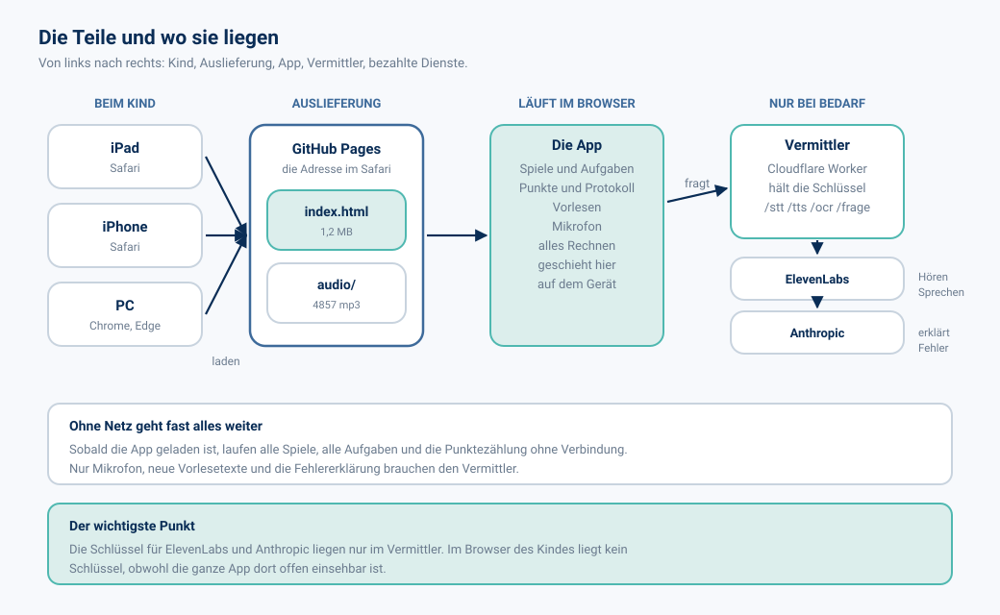
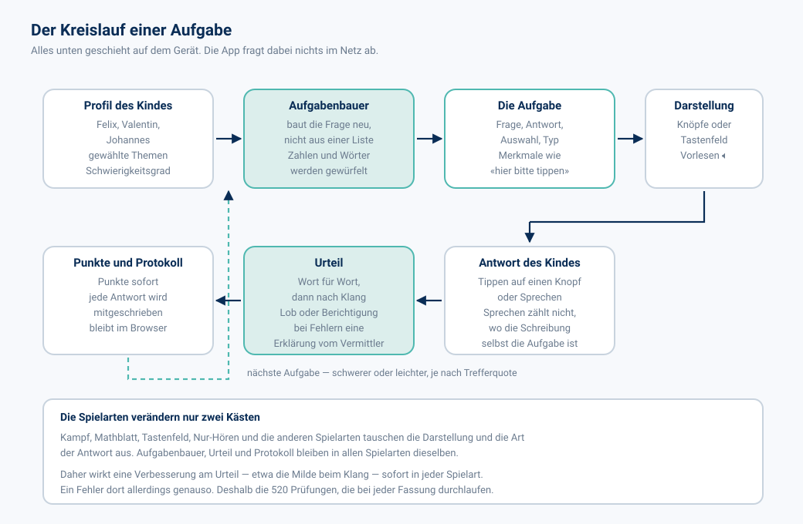
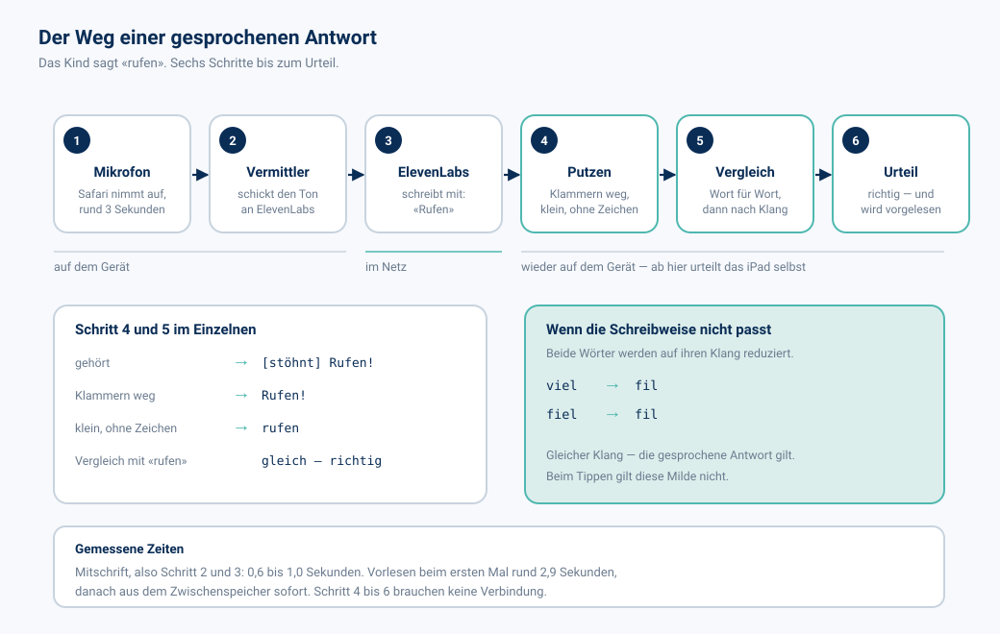
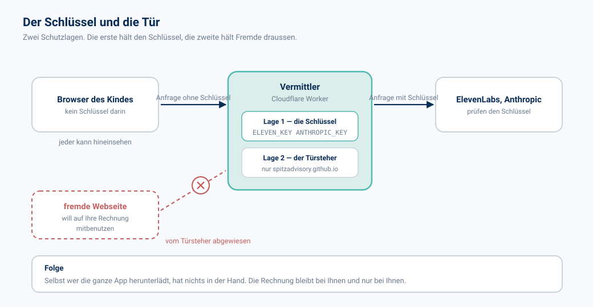
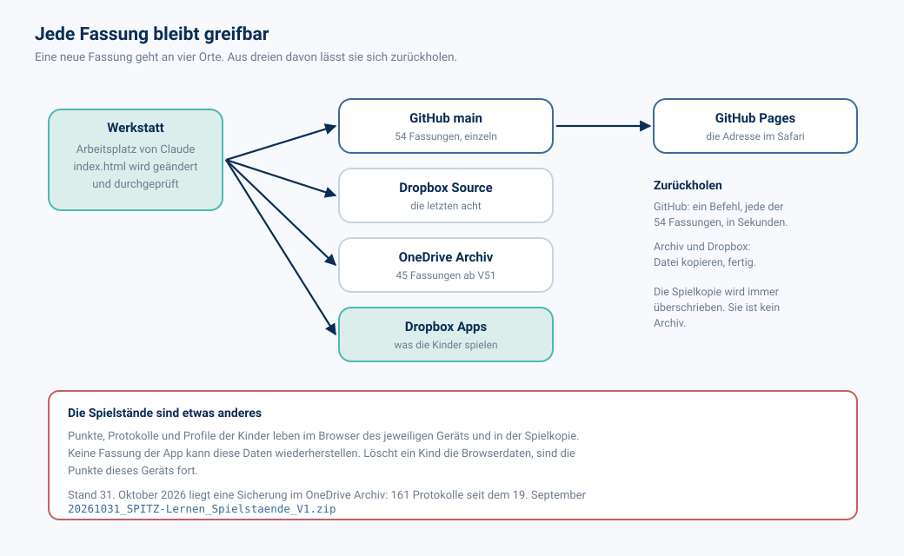

# SPITZ Lernen — die Architektur von heute

Stand 31. Oktober 2026 · Fassung V82 · geschrieben für den Leser ohne Vorkenntnisse

---

## 1. Zweck dieses Dokuments

Die App wird seit dem Sommer Stück für Stück gebaut. Dieses Dokument hält fest, wie sie
heute aufgebaut ist, in gewöhnlichen Worten und mit Bildern. Ein zweites Dokument
beschreibt danach den geplanten Umbau.

Alle Zahlen hier sind am laufenden Programm gemessen, nicht geschätzt.

---

## 2. Die Teile und wo sie liegen

Vier Orte sind beteiligt:

| Ort | Was dort liegt | Wer bezahlt |
|---|---|---|
| Gerät des Kindes | nichts Dauerhaftes ausser Punkten und Protokoll | — |
| GitHub Pages | die App und 4857 Tondateien | kostenlos |
| Cloudflare Worker | die Schlüssel und vier Durchreichen | kostenlos im Rahmen |
| ElevenLabs, Anthropic | Hören, Sprechen, Fehlererklärung | nach Verbrauch |

Die ganze App ist **eine einzige Datei**: `index.html`, 1 205 646 Bytes, 8954 Zeilen,
405 Funktionen. Kein Bauschritt, keine Bibliothek, kein Gerüst. Ein Doppelklick
genügt, und das Programm läuft.

---

## 3. Der Kreislauf einer Aufgabe

Entscheidend ist der zweite Kasten. Die Aufgaben stehen nicht in einer Liste, sondern
werden bei jedem Durchgang neu gewürfelt. Dadurch kann ein Kind dasselbe Thema
zwanzigmal spielen, ohne dieselbe Aufgabe zweimal zu sehen.

Der Nachteil davon: ein Fehler im Aufgabenbauer erzeugt nicht eine falsche Aufgabe,
sondern eine ganze Gattung falscher Aufgaben. Deshalb die 480 Prüfungen in 27 Dateien,
die vor jeder Auslieferung durchlaufen.

---

## 4. Der Umfang in Zahlen

| Bereich | Themen | Beispiel |
|---|---:|---|
| Mathematik und Geometrie | 190 | «Anzahlen bis 20», «Mittelsenkrechte» |
| Französisch Wortschatz | 61 | «Begrüssung und Höflichkeit» |
| Medien und Informatik | 33 | «Eingabe und Ausgabe» |
| Französisch Grammatik | 20 | «être – sein» |
| Deutsch | 13 | «Stammformen schreiben» |
| Englisch Open World | 10 | «Unit 1: Going places» |
| **Summe** | **327** | |

Dazu kommen 76 deutsche Verben mit ihren Stammformen und die Tondateien: 4857 mp3 in
drei Sprachen, zusammen 100 MB.

Die Oberfläche spricht Deutsch, Englisch und Französisch. Der Lernstoff selbst immer
nur seine eigene Sprache.

Sechs Spielarten stehen zur Wahl: der gewöhnliche Durchgang, Lernen, Zeitspiel,
Überleben, Zweikampf und seit V80 das reine Hören ohne Hinsehen.

---

## 5. Der Weg einer gesprochenen Antwort

Dieser Weg hat uns im Oktober drei Fassungen gekostet, und zwar an zwei Stellen, die
im Bild harmlos aussehen.

**Schritt 3 liefert mehr als gesprochen wurde.** ElevenLabs schreibt auch
Geräusche mit und setzt sie in eckige Klammern. Ein Räuspern wurde so zu `[stöhnt]`
und landete als Antwort im Feld. Behoben an beiden Enden: die App wirft Klammern weg,
und der Vermittler verlangt diese Zusätze gar nicht mehr.

**Schritt 5 war zu streng.** «Fallen, viel gefallen» galt als falsch, weil das Kind
«viel» sagte und «fiel» gemeint war. Beides klingt gleich; kein Spracherkenner der Welt
trennt das. Seit V79 werden beide Wörter auf ihren Klang reduziert und erst dann
verglichen. Geprüft an allen 304 Verbformen: nur drei Paare fallen dabei zusammen, und
alle drei sind echte Gleichklinger.

Beim Tippen gilt diese Milde nicht. Fünf Themen üben die Schreibweise selbst; dort
nimmt die App gesprochene Antworten nicht an und sagt das auch.

---

## 6. Der Schlüssel und die Tür

Die App liegt offen im Netz. Jeder kann sie herunterladen und hineinsehen. Deshalb
steht kein Schlüssel darin.

Beide Schutzlagen sind nötig. Die erste hält den Schlüssel aus dem Browser heraus.
Die zweite verhindert, dass eine fremde Webseite den Vermittler als kostenlosen
Dienst missbraucht.

---

## 7. Fassungen und Sicherung

Einzelheiten dazu im Dokument `20261031_SPITZ-Lernen_Stand-und-Sicherung_V1.md`:
die Tabelle aller 54 Fassungen, der Befehl zum Zurückholen und die zwei offenen
Punkte.

---

## 8. Die Rechnung der Bauweise

Eine einzige Datei ohne Bauschritt ist eine ungewöhnliche Wahl. Sie hat uns bisher
mehr genützt als gekostet.

**Dafür spricht:**

- Jede Fassung ist ein einziges Artefakt. Zurückholen heisst: eine Datei kopieren.
- Nichts kann veralten. Keine Abhängigkeit, kein Sicherheitsupdate, kein Bauwerkzeug,
  das in zwei Jahren nicht mehr läuft.
- Die App läuft auch ohne Netz, sobald sie geladen ist.
- Ein Doppelklick auf die Datei genügt zum Prüfen.

**Dagegen spricht:**

- 8954 Zeilen in einer Datei sind unübersichtlich. Jede Änderung geschieht über
  genaue Textersetzung mit Sicherungen, nicht über eine Entwicklungsumgebung.
- Die Datei wird bei jedem Aufruf ganz geladen: 1,2 MB. Über Mobilfunk merkbar,
  im WLAN nicht.
- Teile lassen sich nicht einzeln austauschen. Eine Änderung am Urteil betrifft
  sofort alle 327 Themen und alle sechs Spielarten.

Der dritte Punkt ist der ernsteste. Er ist auch der Grund, warum die Prüfungen
mitgewachsen sind: von einer Handvoll im August auf heute 480.

---

## 9. Grenzen im heutigen Stand

| Grenze | Folge | Behandelt im Umbau |
|---|---|---|
| Spielstände leben nur im Browser des Geräts | Browserdaten löschen heisst Punkte verlieren | ja |
| Der Worker wird von Hand über die Zwischenablage eingespielt | langsam, fehleranfällig | ja |
| Das Archiv hat keine Marken, nur Botschaften | Zuordnung über eine Tabelle statt über einen Namen | ja |
| Kein Gesprächspartner zum Üben | Sprechen bleibt Einzelwort-Antwort | ja, Schritt 3 bis 6 |
| Die Verbenliste Teil 2 fehlt | Flade-Stammformen unvollständig | nein, wartet auf Sie |
| Eine englische Vokabel ohne Beispielsatz: «distance» | eine Aufgabe fehlt | nein |
| Die maschinell gebaute englische Spalte von dis donc | ungeprüft durch eine Lehrperson | nein |

---

*SPITZ Lernen · Urs Spitz · dieses Dokument gehört zum Satz der Unterlagen im
Ordner `docs/` des Projektarchivs.*
