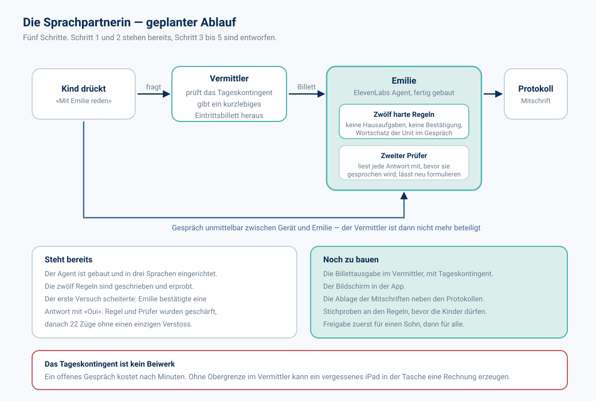
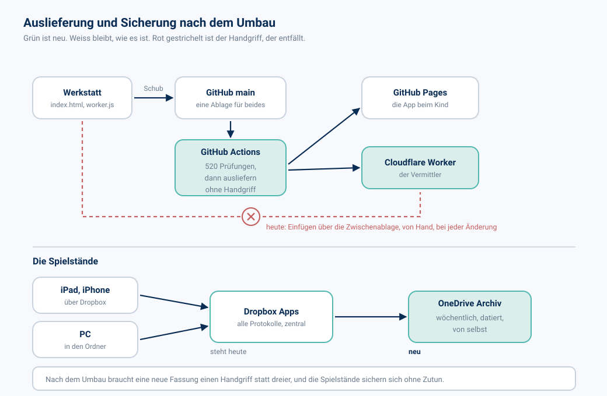

# SPITZ Lernen — die Architektur nach dem Umbau

Stand 31. Oktober 2026 · Entwurf · Gegenstück zu `20261031_SPITZ-Lernen_Architektur-heute_V1.md`

---

## 1. Zweck dieses Dokuments

Fünf Änderungen stehen an. Eine davon ist zur Hälfte gebaut, zwei warten auf Ihre
Entscheidung, zwei sind reine Fleissarbeit.

Das Grundgerüst bleibt unangetastet: eine Datei, kein Bauschritt, der Schlüssel im
Vermittler. Die Gründe dafür stehen im ersten Dokument und sind nicht neu zu erörtern.

---

## 2. Die fünf Änderungen im Überblick

| Nr. | Änderung | Gewinn | Stand |
|---:|---|---|---|
| 1 | Sprachpartnerin zum Reden | freies Sprechen statt Einzelwörtern | halb gebaut |
| 2 | Auslieferung ohne Handgriff | ein Schub statt dreier Schritte | wartet auf Entscheidung |
| 3 | Spielstände sichern sich selbst | Verlust wird unmöglich | zu bauen |
| 4 | Versionsmarken im Archiv | Zurückholen über den Namen | Umweg nötig |
| 5 | PC bleibt wach, solange gearbeitet wird | keine Unterbrechung mitten im Lauf | wartet auf Entscheidung |

---

## 3. Änderung 1 — die Sprachpartnerin

Das Kind redet mit Emilie, Kate oder Emilia über das Thema der laufenden Unit. Keine
Aufgaben, keine Noten, ein Gespräch.

**Der schwierigste Teil ist bereits erledigt.** Ein Sprachmodell, das mit einem Kind
über Schulstoff spricht, will von Natur aus helfen. Es bestätigt, es lobt, es
verbessert — und nimmt dem Kind damit genau die Arbeit ab, um die es geht. Der erste
Versuch zeigte das sofort: auf «La cloche? C'est ça?» antwortete die Partnerin «Oui,
la cloche sonne…». Die Regel war zu weich formuliert.

Die Berichtigung bestand aus zwei Teilen. Die erste Regel verbietet jetzt jede Form
der Bestätigung ausdrücklich, auch das zustimmende Wiederholen der Antwort. Zusätzlich
liest ein zweites Modell jede Antwort mit, bevor sie gesprochen wird, und lässt neu
formulieren, sobald eine Bestätigung darin steckt. Danach: 22 Züge ohne Verstoss.

Der zweite Prüfer kostet etwa eine halbe Sekunde Verzögerung. Diesen Preis halte ich
für richtig bezahlt: ein abrupt abgebrochenes Gespräch verstört ein Kind mehr als eine
kurze Pause.

**Das Tageskontingent ist der Grund, warum Schritt 3 vor Schritt 4 kommt.** Ein
Gespräch kostet nach Minuten. Der Bildschirm in der App darf erst entstehen, wenn der
Vermittler die Obergrenze durchsetzt.

---

## 4. Änderung 2 — Auslieferung ohne Handgriff

Heute braucht eine neue Fassung drei Schritte: die App nach GitHub schieben, die
Spielkopie in Dropbox ersetzen, und den Vermittler von Hand über die Zwischenablage in
die Cloudflare-Oberfläche einfügen. Der dritte Schritt ist der schlechteste. Er
geschieht in einem Editor im Browser, er lässt sich nicht prüfen, und er hinterlässt
keine Spur.

Künftig liegt `worker.js` in derselben GitHub-Ablage wie die App. Ein Schub löst dort
einen Arbeitslauf aus: 480 Prüfungen, und bei Erfolg geht die App an GitHub Pages und
der Vermittler an Cloudflare.

**Der Preis dafür:** ein Cloudflare-Zugangsschlüssel muss als Geheimnis in GitHub
hinterlegt werden. Dieser Schlüssel darf nur den einen Worker verändern dürfen, nichts
sonst im Konto. Die Einrichtung geschieht in Ihrer Cloudflare-Oberfläche; den
Schlüsselwert sehe ich dabei nicht und brauche ich auch nicht.

---

## 5. Änderung 3 — Spielstände sichern sich selbst

Punkte und Protokolle sind das einzige im ganzen Aufbau, das sich nicht wiederherstellen
lässt. Jede Fassung der App liegt dreifach; die 161 Protokolle seit dem 19. September
lagen bis heute nur einfach.

Der Weg der Daten ist bereits gut: iPad und iPhone schreiben über Dropbox, der PC in
den Ordner, der dasselbe Dropbox-Verzeichnis ist. Alles läuft zusammen. Es fehlt nur
die datierte Kopie daneben.

Vorgesehen ist ein wöchentlicher Lauf auf dem Dauer-PC, der den Spielordner als
datiertes Archiv ablegt, nach dem gewohnten Schema
`yyyymmdd_SPITZ-Lernen_Spielstaende_Vx.zip`. Die heutige Sicherung von Hand ist der
erste Eintrag dieser Reihe.

---

## 6. Änderung 4 — Versionsmarken im Archiv

Marken in der Ablage wären der natürliche Weg, eine Fassung über ihren Namen
zurückzuholen: `v76` statt eines Commit-Schlüssels. Ich habe 37 solche Marken lokal
erzeugt; das Hochladen hat der Netzübergang dieser Arbeitsumgebung abgewiesen, sowohl
über `git push --tags` als auch über die GitHub-Schnittstelle. Branches gehen durch,
Marken nicht.

Zwei Wege bleiben. Entweder Sie setzen die Marken einmalig selbst — ein Befehl, 37
Marken, eine Minute. Oder es bleibt bei der Tabelle im Sicherungsdokument, die
denselben Dienst tut und nur unbequemer ist.

Mit Änderung 2 löst sich das nebenbei: ein Arbeitslauf in GitHub kann Marken setzen,
weil er innerhalb von GitHub läuft und nicht durch diesen Netzübergang muss.

---

## 7. Änderung 5 — der PC bleibt wach, solange gearbeitet wird

Die Bildschirmsperre unterbricht lange Läufe auf dem Dauer-PC. Dauerhaft entsperrt
soll der Rechner nicht sein.

Vorgesehen ist ein Signal statt einer Dauerlösung: Ich lege beim Arbeiten eine
Merkdatei in einen Ordner, den der PC sieht, und entferne sie am Ende. Eine Aufgabe
auf dem PC hält den Bildschirm wach, solange diese Datei liegt, und lässt die Sperre
sonst ihren gewohnten Lauf nehmen.

Für das iPad ist dieselbe Frage seit V82 erledigt. Die Screen Wake Lock des Browsers
hält den Bildschirm während eines Durchgangs wach und gibt ihn danach frei. Safari
beherrscht das ab iOS 16.4; ältere Geräte verhalten sich wie bisher.

Die eingangs erwogene Maussteuerung über Hot Corners trägt nicht. Hot Corners gibt es
auf dem Mac; iPadOS kennt sie in dieser Form nicht, und auf Windows lösen sie keine
Sperre aus.

---

## 8. Unverändertes

- Eine einzige HTML-Datei, kein Bauschritt, keine Abhängigkeit.
- Die Schlüssel für ElevenLabs und Anthropic nur im Vermittler.
- Die Türsteherregel: nur die eigene Adresse darf den Vermittler nutzen.
- Die 480 Prüfungen vor jeder Auslieferung.
- Der Abgleich mit dem Lehrplan 21 bei jedem neuen Thema.
- Die Ablage der Spielstände über Dropbox mit dem Zugang des Benutzers selbst.

---

## 9. Offene Entscheidung

Die Änderungen 2 und 5 hängen an einer einzigen Antwort von Ihnen, weil beide etwas
auf Ihren Geräten einrichten:

1. Ein Cloudflare-Zugangsschlüssel als Geheimnis in GitHub, beschränkt auf den einen
   Worker.
2. Eine Aufgabe auf dem Dauer-PC, die auf die Merkdatei achtet.

Ohne diese Antwort bleiben Auslieferung und Bildschirmsperre, wie sie heute sind. Die
Änderungen 1, 3 und 4 laufen unabhängig davon weiter.

---

## 10. Vorgeschlagene Reihenfolge

| Schritt | Inhalt | Hängt ab von |
|---:|---|---|
| 1 | Billettausgabe und Tageskontingent im Vermittler | — |
| 2 | Bildschirm der Sprachpartnerin in der App | Schritt 1 |
| 3 | Stichproben an den Regeln, Ablage der Mitschriften | Schritt 2 |
| 4 | Freigabe für einen Sohn, dann für alle | Schritt 3 |
| 5 | Wöchentliche Sicherung der Spielstände | — |
| 6 | Auslieferung über GitHub Actions, Marken inbegriffen | Ihre Antwort |
| 7 | Bildschirmsperre des PC | Ihre Antwort |

Die Schritte 1 bis 4 sind die gewichtigsten und beginnen sofort. Schritt 5 ist eine
knappe Stunde Arbeit und kann dazwischenpassen.

---

*SPITZ Lernen · Urs Spitz · dieses Dokument gehört zum Satz der Unterlagen im
Ordner `docs/` des Projektarchivs.*
